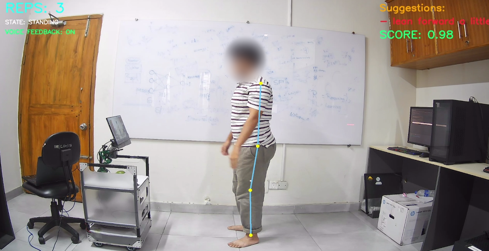

# Squat Assessment

**Real-time squat form analysis with personality-adaptive coaching.**

A MediaPipe-based system that tracks your squat from a webcam or video file, detects form errors (spine, knee depth, knee-over-toe), scores every rep, and generates short spoken coaching cues with a locally running LLM. The cues are tailored to **what went wrong** *and* to the **user's Big Five personality profile**.

<p align="center">
  
</p>
<p align="center"><em>Live analysis: pose landmarks, rep counter, movement state, per-rep score and on-screen suggestions. (Face blurred for privacy.)</em></p>

---

## Features

- **Pose tracking** with MediaPipe Pose (side-view, left-side landmarks)
- **Rep counting** via a 3-state machine driven by knee angle (standing → transition → deep squat)
- **Form error detection** per rep:
  - Bending too far forward / backward (spine angle)
  - Shallow or too-deep squat (knee angle)
  - Knee crossing the toe (ankle angle)
- **Continuous 0–1 scoring** of spine, knee and ankle condition, combined into a weighted rep score
- **Compliance tracking**: checks whether the user improved on the previous rep's errors
- **Personality-adaptive feedback**: a fine-tuned LLM (served by [Ollama](https://ollama.com)) receives the joint conditions, detected issues and the user's Big Five scores, and returns a short cue (max ~18 words)
- **Voice feedback** using offline text-to-speech (`pyttsx3`), spoken when the user returns to standing
- **Session summary** printed at the end: total reps, issues, compliance, average score and feedback viewing time

## How it works

```
Webcam / video ──► MediaPipe Pose ──► joint angles (spine, knee, ankle)
                                            │
                                            ▼
                           state machine (s1 → s2 → s3 → s2 → s1)
                                            │  rep completed
                                            ▼
                      form analysis + scoring (issues, deviations, 0–1 conditions)
                                            │
                  ┌─────────────────────────┴─────────────────────────┐
                  ▼                                                   ▼
        on-screen overlay (issues, score)         Ollama LLM  ◄── Big Five profile
                                                         │
                                                         ▼
                                              short coaching cue ──► text-to-speech
```

### Angles and thresholds

All angles are measured against the vertical using the left shoulder, hip, knee and ankle.

| State | Knee angle | Meaning |
|-------|-----------|---------|
| `s1`  | 0°–30°    | Standing |
| `s2`  | 30°–50°   | Transition |
| `s3`  | 50°–100°  | Deep squat |

| Issue | Trigger |
|-------|---------|
| Bend forward | min spine angle ≤ 10° |
| Bend backward | max spine angle ≥ 40° |
| Shallow squat | max knee angle ≤ 75° |
| Deep squat | max knee angle ≥ 90° |
| Knee crossing toe | max ankle angle ≥ 35° |

The rep score is `0.45 × spine + 0.35 × knee + 0.20 × ankle`, where each term is a 0–1 condition value that degrades smoothly as the angle moves past its threshold.

## Repository structure

```
.
├── v3_person.py        # main application (pose tracking, scoring, LLM + TTS)
├── modelv2             # Ollama Modelfile for the coaching model
├── requirements.txt    # Python dependencies
├── docs/images/        # README images
├── LICENSE
└── README.md
```

## Installation

**Requirements:** Python 3.8–3.12, a webcam (or a recorded video), and [Ollama](https://ollama.com/download) if you want LLM feedback.

```bash
git clone https://github.com/<your-username>/Squat-Assessment.git
cd Squat-Assessment

python -m venv venv
source venv/bin/activate        # Windows: venv\Scripts\activate

pip install -r requirements.txt
```

### Set up the coaching model (optional but recommended)

The fine-tuned model weights are **not** stored in this repository (they are too large for Git). They are hosted on Hugging Face:

**[Aesope/Llama-3.2-Squat-Coach](https://huggingface.co/Aesope/Llama-3.2-Squat-Coach)**

1. Download the GGUF file into the project folder:

   ```bash
   pip install -U huggingface_hub
   hf download Aesope/Llama-3.2-Squat-Coach squatcoachv3.gguf --local-dir .
   ```

2. Register it with Ollama under the name the script expects:

   ```bash
   ollama create squatper -f modelv2
   ```

3. Make sure Ollama is running (`http://localhost:11434`).

The model is a fine-tune of Llama 3.2 and is subject to the [Llama 3.2 Community License](https://www.llama.com/llama3_2/license/). Built with Llama.

> No model? Set `USE_OLLAMA = False` at the top of `v3_person.py`. Rep counting, scoring and the on-screen feedback still work; only the LLM cues and the Big Five prompt are skipped.
## Usage

```bash
# Webcam
python v3_person.py webcam

# Video file
python v3_person.py path/to/squat_video.mp4

# Interactive menu (choose webcam or video)
python v3_person.py
```

When LLM feedback is enabled you will be asked for your **Big Five personality scores (1–10)**: openness, conscientiousness, extraversion, agreeableness and neuroticism. Press Enter to keep the default of 5.0 for any trait. Press **`q`** in the video window to quit.

**Camera tips:** film from the side, with your **left side facing the camera**, and keep your whole body (head to feet) in frame with good lighting.

## Configuration

Settings live at the top of `v3_person.py`:

| Variable | Default | Description |
|----------|---------|-------------|
| `USE_OLLAMA` | `True` | Enable/disable LLM feedback |
| `OLLAMA_MODEL` | `"squatper"` | Name of the local Ollama model |
| `OLLAMA_URL` | `http://localhost:11434/api/generate` | Ollama endpoint |
| `OLLAMA_TIMEOUT` | `30` | Request timeout (seconds) |
| `LLM_INTERVAL_SECONDS` | `2` | Gap between LLM calls after the first rep |
| `USE_TTS` | `True` | Enable/disable spoken feedback |
| `TTS_RATE` / `TTS_VOLUME` | `170` / `1.0` | Speech speed and volume |
| `TTS_VOICE_INDEX` | `None` | Pick a specific system voice |

## Troubleshooting

- **`module 'mediapipe' has no attribute 'solutions'`**: the script uses MediaPipe's legacy Solutions API. Install the pinned version: `pip install mediapipe==0.10.14`.
- **`[Ollama error] ... Connection refused`**: Ollama isn't running, or the model name doesn't match `OLLAMA_MODEL`. Check with `ollama list`.
- **No spoken feedback**: confirm your OS has a TTS voice installed (`pyttsx3` uses SAPI5 on Windows, NSSpeechSynthesizer on macOS and eSpeak on Linux).
- **"No pose detected"**: move back until your full body is visible and improve the lighting.

## Limitations

- Single person, **side-view** analysis only; angles are computed in 2D from the left side of the body.
- Thresholds are fixed heuristics, not personalised to body proportions or squat variation.
- This is a research prototype for exercise feedback, **not a medical or physiotherapy tool**.

## Contributing

Issues and pull requests are welcome. For larger changes, please open an issue first to discuss what you'd like to change.

## License

The code is released under the [MIT License](LICENSE). The model weights are licensed separately under the Llama 3.2 Community License (see above).

## Acknowledgements

- [MediaPipe](https://github.com/google-ai-edge/mediapipe) for pose estimation
- [Ollama](https://ollama.com) for local LLM serving
- [OpenCV](https://opencv.org) and [pyttsx3](https://github.com/nateshmbhat/pyttsx3)
